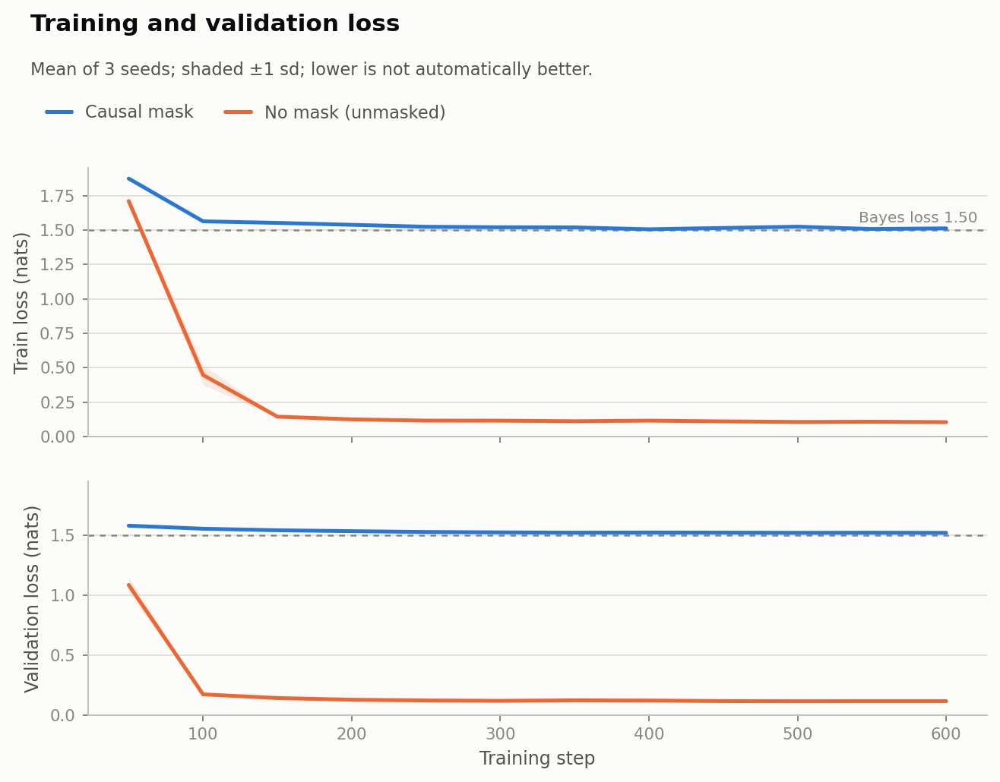
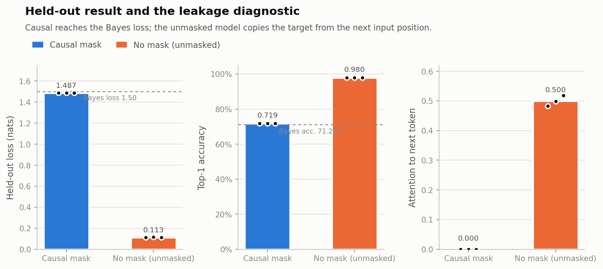

# Small transformer experiment

**Causal mask vs. no mask: a controlled leakage experiment**

**Decision:** the result worth reporting is the **causal-mask** model, not the
lower-loss unmasked model. The unmasked model's held-out loss is lower because
the target token is also present in its input at the next position; it is
copying from the future, not predicting. The simple, interpretable intervention
(causal masking) produces a less impressive headline but a valid one: its
held-out loss is **1.487 nats**, essentially the theoretical Bayes loss
(**1.501 nats**), and its future attention is exactly **0**. The unmasked model
reaches **0.113 nats** and **50% attention to the next token** — a benchmark
artifact, not a model improvement.

| Model | Test loss (nats) | Top-1 accuracy | Attention to next token | Future attention |
|---|---:|---:|---:|---:|
| **Causal mask (valid)** | **1.487 ± 0.001** | **71.88% ± 0.00%** | **0.000** | **0.000** |
| No mask (unmasked) | 0.113 ± 0.002 | 98.00% ± 0.01% | 0.500 ± 0.018 | 0.093 |
| Bayes reference | 1.501 | 71.25% | — | — |

> This is an assessment scenario, not a claim about language modeling at scale.
> The data are synthetic Markov sequences, the model is ~70k parameters, and the
> experiment has 3 seeds. Sections 5–6 state the limitations.

---

## 1. The decision

The brief offers a choice between an ambitious intervention that may improve a
benchmark but is hard to interpret and a simple intervention that teaches more
while producing a less impressive headline. I chose the simple intervention:

* **Baseline:** the supplied attention with `causal=False` — bidirectional
  attention over the input.
* **Intervention:** the same attention with `causal=True` — a causal mask.
* **Everything else fixed:** data, seed, initial weights, optimizer, steps and
  evaluation. The only difference is the mask.

The unmasked model's lower loss is not a win. In next-token prediction the input
is `x[0..T-1]` and the target at position `i` is `x[i+1]`. A bidirectional model
can attend to input position `i+1`, which **is the target token**. The causal
model cannot. The experiment makes that mechanism visible rather than reporting
the invalid benchmark as a result.

## 2. Data

Synthetic sequences from a first-order Markov chain:

* vocabulary 24, sequence length 16 (input length 15);
* with probability **0.7** the next token is `(token * 7 + 3) % 24`; otherwise
  uniform noise;
* 12,000 train / 2,000 validation / 2,000 test sequences, fixed seed;
* saved to `data/tiny_lm_data.npz` for exact reproducibility.

The data-generating process has a known Bayes predictor:

* **Bayes loss = 1.5014 nats**
* **Bayes top-1 accuracy = 0.7125**

A causal model that learns the transition should approach those numbers. An
unmasked model that copies the next input token can go far below them — which is
exactly why its low loss is not a valid next-token result.

## 3. Model and protocol

* 2 transformer blocks, 4 heads, `d_model=64`, `d_ff=128`, context 15,
  vocabulary 24; **69,632 parameters**.
* Token and output embeddings tied; learned positional embeddings; pre-LN
  residual blocks; GELU MLP.
* 600 AdamW steps, batch 64, learning rate 3e-3, weight decay 0.01, gradient
  clipping 1.0.
* Best validation checkpoint; held-out test evaluated once.
* 3 seeds per condition. For each seed, the unmasked and causal models are
  created with the **same seed, same initial weights and same batch order**; the
  causal flag changes only the attention mask.
* Attention diagnostic: mean attention weight from query `i` to key `i+1`
  (the direct copy path) and to all future keys, averaged over heads, blocks,
  positions and a 64-sequence test batch.

## 4. Attention component tests

`tiny_attention.py` implements scaled dot-product attention with a causal mask
in NumPy and tests it against the supplied `transformer-baseline.py`:

| Test | Result |
|---|---|
| Matches the baseline, `causal=False` | pass (max abs diff 2.22e-16) |
| Matches the baseline, `causal=True` | pass (max abs diff 2.22e-16) |
| Future key/value perturbation ignored when causal | pass |
| Future perturbation changes the output when non-causal | pass |

This is the "complete a tiny attention or masking component" requirement; the
same masking logic is implemented in the PyTorch model used for training.

## 5. Results

### 5.1 Per-seed held-out metrics

| Model | Seed | Train loss | Best val loss | Test loss | Test acc. | Next-token attn. | Future attn. |
|---|---:|---:|---:|---:|---:|---:|---:|
| Causal | 0 | 1.5111 | 1.5199 | 1.4862 | 0.7188 | 0.0000 | 0.0000 |
| Causal | 1 | 1.5131 | 1.5225 | 1.4877 | 0.7188 | 0.0000 | 0.0000 |
| Causal | 2 | 1.5122 | 1.5216 | 1.4882 | 0.7188 | 0.0000 | 0.0000 |
| Unmasked | 0 | 0.1011 | 0.1128 | 0.1128 | 0.9801 | 0.4831 | 0.0939 |
| Unmasked | 1 | 0.1056 | 0.1139 | 0.1151 | 0.9799 | 0.4985 | 0.0925 |
| Unmasked | 2 | 0.1060 | 0.1127 | 0.1116 | 0.9801 | 0.5189 | 0.0936 |

### 5.2 Summary (mean ± sd across 3 seeds)

| Model | Test loss | Top-1 accuracy | Next-token attention | Future attention |
|---|---:|---:|---:|---:|
| **Causal mask** | **1.4874 ± 0.0010** | **0.7188 ± 0.0000** | **0.0000 ± 0.0000** | **0.0000** |
| No mask | 0.1132 ± 0.0018 | 0.9800 ± 0.0001 | 0.5002 ± 0.0179 | 0.0933 |
| Bayes reference | 1.5014 | 0.7125 | — | — |

The causal model lands **slightly below** the Bayes loss (1.487 vs 1.501) and
slightly above the Bayes accuracy (71.88% vs 71.25%). The difference is
finite-test-sample noise, not evidence of a better-than-Bayes predictor; the
correct reading is "the causal model has learned the task." The unmasked model
is far below the Bayes loss, which is the signature of information it should not
have.

**Position control.** The same held-out set, split by position:

| Model | Positions 0–13 (target is in the input at `i+1`) | Position 14 (no future input token) |
|---|---:|---:|
| Causal mask | 1.4821 | 1.5604 |
| No mask (unmasked) | **0.0020** | **1.6701** |
| Bayes reference | 1.5014 | 1.5014 |

The unmasked model's loss on positions 0–13 is essentially zero: it copies the
target from the next input position. At the last position there is no future
token to copy, and its loss jumps to 1.6701 — back in the same range as the
causal model (1.5604) and the Bayes loss (1.5014). The causal model's two
position losses are similar (1.4821 / 1.5604). This is the cleanest control:
the leakage is localised exactly where the target is available in the input,
and it disappears where it is not.

### 5.3 Predictions (seed 0, first test sequence)

```
input   = [4, 21, 6, 21, 6, 8, 4, 7, 4, 7, 4, 21, 2, 17, 1]
target  = [21, 6, 21, 6, 8, 4, 7, 4, 7, 4, 21, 2, 17, 1, 20]

unmasked= [21, 6, 21, 6, 8, 4, 7, 4, 7, 4, 21, 2, 17, 1, 10]
causal  = [ 7, 6, 21, 6, 21, 11, 7, 4, 7, 4, 7, 6, 17, 2, 10]
```

The unmasked model copies the target for positions 0–13, where the target is
also the next input token. At position 14 the target (`20`) is **not** in the
input, and the unmasked model predicts `10`. The causal model predicts the
deterministic successor `(7, 6, 21, 6, ...)`; its errors are the 30% noise
positions (for example, position 0: target 21, deterministic successor 7; the
causal model predicts 7). This is the mechanism in one example.

### 5.4 Figures





## 6. What I would report, qualify or withhold

**Report:**

* the causal model's held-out loss (1.487 nats) and top-1 accuracy (71.88%),
  next to the Bayes reference (1.501 / 71.25%);
* the unmasked model's metrics **as a leakage diagnostic**, not as a candidate
  model: 0.113 nats, 98.00% accuracy, 0.500 next-token attention;
* the position control: 0.0020 on positions 0–13 and 1.6701 on the last position
  for the unmasked model, versus 1.4821 / 1.5604 for the causal model;
* the sample predictions, including the last position where even the unmasked
  model cannot copy;
* the 3-seed spread and the attention component tests;
* the limitation that this is a synthetic mechanism experiment.

**Qualify:**

* the causal model's loss is slightly below Bayes; call it "approximately
  Bayes", not "better than Bayes";
* the unmasked model's accuracy is not a language-modeling result; 14 of 15
  positions have the target in the input;
* the attention diagnostic is a mechanism check, not a proof that every
  unmasked model copies in the same way.

**Withhold / reject:**

* the unmasked model's 0.113 loss as a performance win or a headline;
* any claim that causal masking "improves" performance — it makes the
  next-token benchmark **valid**, and the valid loss is higher;
* any claim about real language, larger models or scaling; the experiment is one
  controlled mechanism demonstration.

**The responsible conclusion:** causal masking is necessary for next-token
prediction. A bidirectional model evaluated on the same next-token task has an
information advantage and its lower loss is not comparable. The intervention is
worth reporting because it isolates that mechanism; the unmasked number is worth
reporting only as the size of the leakage.

## 7. Assumptions

1. The synthetic Markov process is a proxy for a next-token task, not a claim
   about natural language.
2. The baseline is the supplied attention with `causal=False`; the intervention
   is `causal=True`. One design change only.
3. The model is deliberately tiny; 3 seeds and 600 steps are enough to learn the
   synthetic transition, not to tune an architecture.
4. The Bayes loss/accuracy are computed analytically from the data-generating
   process.
5. The attention diagnostic reads the attention weights of the first block of
   each layer; copying could in principle use other paths, so it is a diagnostic,
   not a causal proof.
6. Tied embeddings and no dropout keep the comparison controlled; no
   hyperparameter search was performed.

## 8. Limitations and what remains unknown

* **Synthetic data.** The result demonstrates a mechanism; it does not establish
  anything about natural-language perplexity or downstream quality.
* **Tiny model, short context, 3 seeds.** No scaling or architecture claims.
* **The unmasked loss is not a valid benchmark.** It is reported as a leakage
  diagnostic. The experiment is designed to make that interpretation explicit.
* **The causal model is near Bayes, not exactly Bayes.** The test set is finite;
  1.487 vs 1.501 is sampling noise.
* **The last position is not leaky even for the unmasked model.** The target at
  position 14 is not in the input; the unmasked model's loss is a mixture of 14
  leaky positions and one honest position. The next-token attention diagnostic
  uses positions 0–13.
* **Attention is not the only possible copy path.** A model could copy via
  residual/positional features or later blocks; the first-block attention is a
  direct mechanism indicator, not a full circuit analysis.
* **No real tokenizer, no real corpus, no architecture search.** The
  "ambitious" alternative (a larger model or a different architecture) was
  deliberately not run; it would confound size, optimization and data with the
  masking question.
* **One controlled comparison.** The brief asks for one; I did not test other
  masking variants (sliding window, random mask) or larger models.

## 9. Reproducibility

Requirements: Python 3.11 (tested with 3.11.1), `numpy==1.26.4`,
`pandas==2.2.3`, `matplotlib==3.10.0`, `torch==2.14.1` (CPU).

```bash
python -m pip install -r requirements.txt
python tiny_attention.py          # attention component tests
python transformer_experiment.py  # training experiment (~70 s on CPU)
python make_figures.py
```

If the default PyTorch wheel is not CPU-only, install the CPU build:

```bash
python -m pip install torch==2.14.1 --index-url https://download.pytorch.org/whl/cpu
```

`transformer_experiment.py` writes:

```
results/report.txt
results/metadata.json
results/metrics.csv          # per seed x model
results/summary.csv          # mean ± sd
results/training_curves.csv  # step x model x seed
results/predictions.csv      # sample held-out predictions
results/attention_tests.json
```

`make_figures.py` writes `results/figures/fig1_training_curves.png` and
`fig2_heldout_and_leakage.png`.

The synthetic dataset is generated deterministically and saved to
`data/tiny_lm_data.npz`. Training is seeded; small numerical differences between
runs are possible due to CPU thread scheduling, but the mask effect is far
larger than that noise.

### Files

| File | Purpose |
|---|---|
| `tiny_attention.py` | NumPy attention/masking component + tests against the baseline |
| `transformer_experiment.py` | Data, tiny transformer, training, diagnostics, report |
| `make_figures.py` | Report figures |
| `data/tiny_lm_data.npz` | Deterministic synthetic dataset |
| `results/` | Report, metrics, curves, predictions, attention tests |
| `transformer-baseline.py` | Supplied baseline, kept unchanged |
| `transformer-brief.md` | Supplied brief |

## 10. AI assistance disclosure

AI assistance (Claude Code) was used to implement the attention component and
training experiment, generate the figures and draft this README and the decision
journal. The experiment was re-run and the reported numbers were checked during
preparation. The candidate owns the final submission and is responsible for the
reasoning and for defending it without AI assistance during an on-site
interview; see the note at its top.

## 11. Requirement checklist

| Brief requirement | Where it is met |
|---|---|
| Complete a tiny attention or masking component | `tiny_attention.py`; tests match the baseline within 2.22e-16; causal mask invariance verified |
| Compare one intervention against a fixed baseline | Section 1: causal mask vs supplied `causal=False`; everything else fixed; 3 seeds |
| Report held-out loss, predictions and limitations | Sections 5.1–5.3, 6–8 |
| Decision journal (four questions) | `decision-journal.md` |
| AI assistance disclosed | Section 10 and the journal note |
