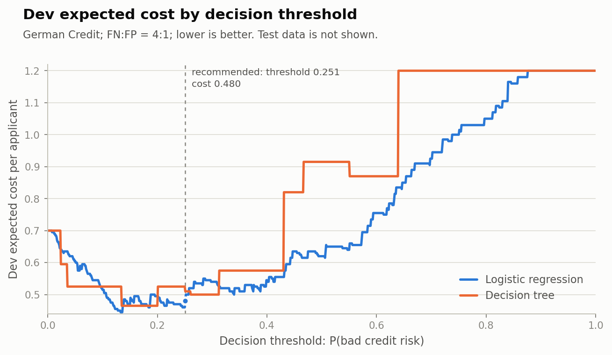
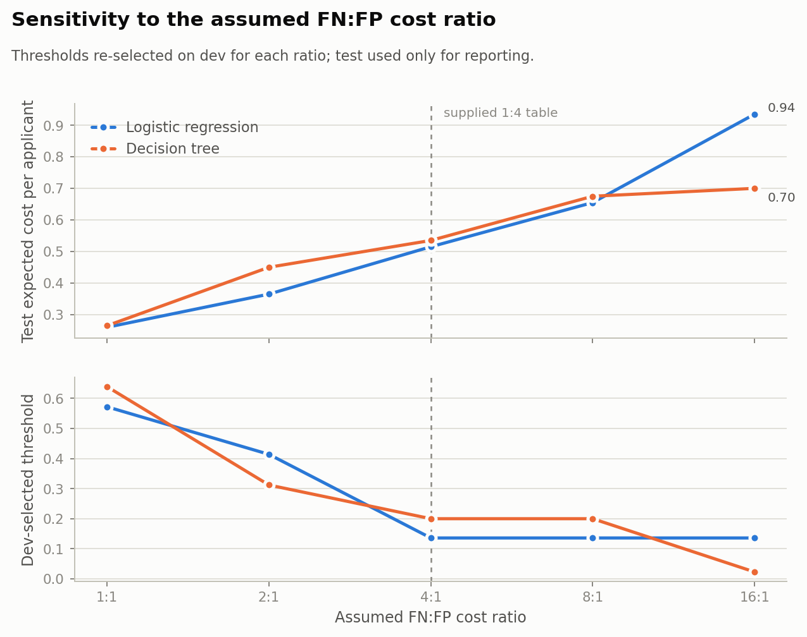
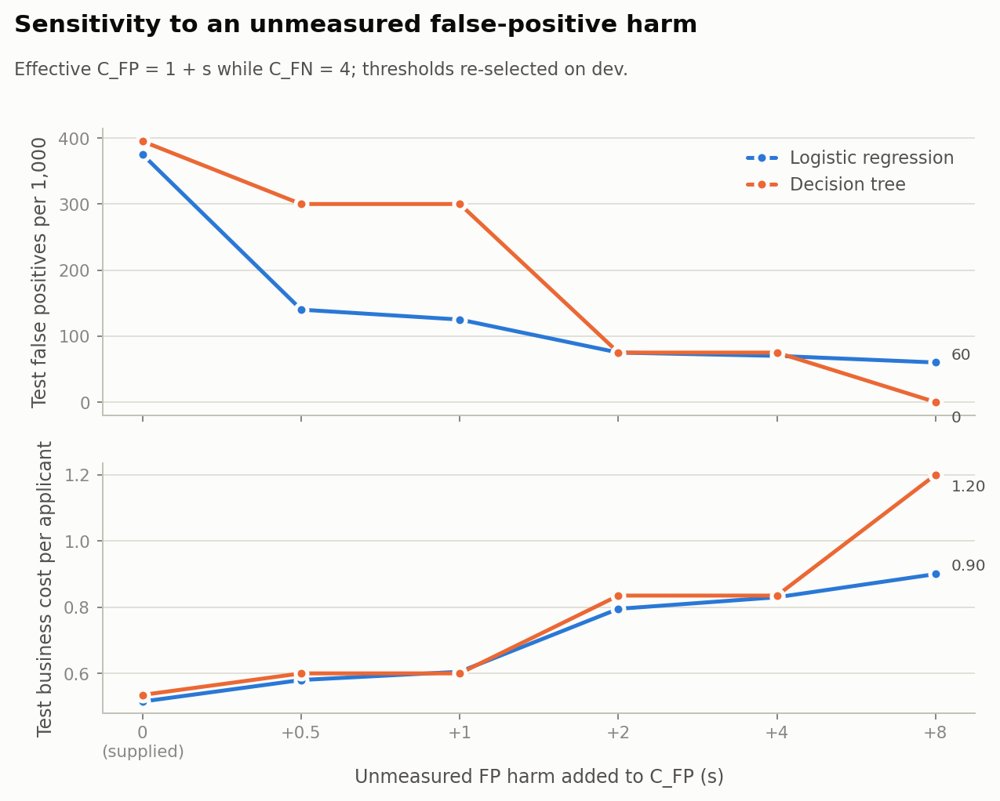

# Cost-sensitive decision models

**Logistic regression vs. decision tree on German Credit**

**Recommendation:** use **logistic regression** at a decision threshold of
**0.251** on the predicted probability of bad credit risk. On the held-out test
set this gives an expected cost of **0.495 per applicant**, with **47 false
positives and 13 false negatives per 200 applicants** (235 FP and 65 FN per
1,000). The pure cost-minimising threshold (0.136) would flag 75 good applicants
per 200 (375 per 1,000); I do not recommend it, because the supplied 1:4 cost
table does not price the harm of a wrongful rejection.

> This is an assessment scenario, not a claim about a real lender. The dataset is
> a public proxy, the cost table is assumed, and the test set is small. Sections
> 6–7 state what remains unknown.

---

## 1. Decision scenario and stakeholders

The supplied cost table charges a false negative (FN) four times as much as a
false positive (FP). I use the UCI German Credit data and define the positive
class as **bad credit risk** (the applicant would default):

| Outcome | Meaning | Cost |
|---|---|---|
| FN | a bad-risk applicant is approved | 4 |
| FP | a good-risk applicant is rejected or flagged | 1 |

The business owner bears the FN loss. Two less visible groups bear the FP
consequence:

* **creditworthy applicants who are wrongly rejected** — lost access, time,
  stigma, and possibly financial harm;
* **the staff who investigate flags** — each FP is a manual review, so the FP
  count is also a workload measure.

The cost table counts neither of these consequences explicitly. The analysis
therefore reports FP counts in absolute terms and tests how the recommendation
moves when an explicit extra FP cost is added. The recommendation below is
conditional on the supplied table and on the review capacity being able to
handle the reported flag volume.

## 2. Data

No modelling dataset was supplied with the brief (the baseline contains four
illustrative rows). I use the
[UCI Statlog German Credit dataset](https://archive.ics.uci.edu/ml/machine-learning-databases/statlog/german/german.data):

* 1,000 rows, 20 features, no missing values;
* target: 1 = good credit, 2 = bad credit; **positive class = bad credit**
  (300 / 1,000 = 30%);
* 7 numeric and 13 categorical features;
* a local copy is committed at `data/german.data`, so the experiment runs
  offline. SHA-256:
  `b21f3d81db8071257d5ff1deaeba1fd4303b62712e6fcc9715c7a86202cb5871`.

This dataset is a proxy for a lending decision, not the task's original data.
That choice is an explicit assumption, not a measured result.

## 3. Protocol

* **Split:** stratified 60/20/20 train/dev/test (600 / 200 / 200), seed 42.
  The test set is used only for reporting; it is never used to select a model,
  threshold or hyperparameter.
* **Preprocessing:** numeric features standardised for logistic regression;
  categorical features one-hot encoded. All preprocessing is fitted inside a
  pipeline on the training set only.
* **Models (pre-specified, not tuned on test):**
  * logistic regression: L2, `lbfgs`, `max_iter=5000`;
  * decision tree: `max_depth=4`, `min_samples_leaf=20`.
* **Threshold grid:** 0.001 to 0.999 in 999 steps. Expected cost per applicant =
  `(FP × 1 + FN × 4) / n`. The cost-optimal threshold is selected **on dev
  only**; ties go to the higher threshold (fewer FPs).
* **Model selection:** lower **dev** expected cost at the cost-optimal
  threshold; a tie within 0.001 goes to logistic regression because its
  probabilities are smoother. The comparison is made before the FP guard so that
  the model ranking is not confounded by the guard; the guard is then applied to
  the selected model's threshold.
* **FP guard (pre-registered value judgment):** among thresholds whose dev cost
  is within **+10%** of the dev minimum, take the highest threshold (fewest FPs),
  but only if it cuts dev FP by **at least 25%**. Otherwise keep the
  cost-optimal threshold. This rule is fixed before looking at test results.
* **Uncertainty:** 2,000-resample bootstrap CIs for test cost; paired bootstrap
  for the LR − DT cost difference; the whole procedure repeated on 11
  stratified splits (seeds 42 and 0–9).
* **Sensitivity:** thresholds re-selected on dev for FN:FP ratios
  {1, 2, 4, 8, 16} and for an added FP harm `s` with effective `C_FP = 1 + s`,
  `s ∈ {0, 0.5, 1, 2, 4, 8}`. Test is used only for reporting in every case.
* **Baseline check:** the supplied 4-row `evaluate` logic is reproduced at the
  start of the script (`{0.2: 0.25, 0.5: 1.25, 0.8: 1.0}`). It is a logic
  check, not empirical evidence.

## 4. Results

### 4.1 Dev threshold selection (n = 200; 60 bad-risk applicants)

| Model | Rule | Threshold | Dev cost | Dev FP | Dev FN |
|---|---|---:|---:|---:|---:|
| Logistic regression | cost-optimal | 0.136 | 0.445 | 77 | 3 |
| Logistic regression | FP-guarded | 0.251 | 0.480 | 52 | 11 |
| Decision tree | cost-optimal | 0.200 | 0.465 | 73 | 5 |
| Decision tree | FP-guarded | 0.312 | 0.500 | 56 | 11 |

The FP guard is worthwhile for logistic regression (+7.9% dev cost for −32.5%
FP) and not worthwhile for the decision tree (23.3% FP reduction, below the
pre-registered 25% bar). The model selected on dev is **logistic regression**
(dev cost 0.445 vs. 0.465 at the cost-optimal thresholds). The theoretical Bayes
threshold for calibrated probabilities is `1 / (1 + 4) = 0.200`.

### 4.2 Held-out test results (seed 42; used for reporting only)

| Model | Rule | Threshold | TP | FP | FN | TN | Expected cost | FP / 1,000 | FN / 1,000 | Precision | Recall |
|---|---|---:|---:|---:|---:|---:|---:|---:|---:|---:|---:|
| Logistic regression | cost-optimal | 0.136 | 53 | 75 | 7 | 65 | 0.515 | 375.0 | 35.0 | 0.414 | 0.883 |
| **Logistic regression** | **FP-guarded (recommended)** | **0.251** | **47** | **47** | **13** | **93** | **0.495** | **235.0** | **65.0** | **0.500** | **0.783** |
| Logistic regression | fixed 0.50 (reference) | 0.500 | 31 | 20 | 29 | 120 | 0.680 | 100.0 | 145.0 | 0.608 | 0.517 |
| Decision tree | cost-optimal | 0.200 | 53 | 79 | 7 | 61 | 0.535 | 395.0 | 35.0 | 0.402 | 0.883 |
| Decision tree | FP-guarded | 0.312 | 45 | 60 | 15 | 80 | 0.600 | 300.0 | 75.0 | 0.429 | 0.750 |
| Decision tree | fixed 0.50 (reference) | 0.500 | 24 | 19 | 36 | 121 | 0.815 | 95.0 | 180.0 | 0.558 | 0.400 |

Threshold-independent ranking: **AUC 0.791 (LR) vs. 0.727 (DT)**.

The decision tree's final rule is its cost-optimal 0.200, because its FP guard
did not meet the 25% criterion. At the recommended LR threshold, **94 of 200
applicants (47%) are flagged**, compared with a 30% bad-risk base rate; half of
the flags are false. This number is the consequence I refuse to hide.

### 4.3 Bootstrap uncertainty (2,000 resamples)

| Estimate | Cost | 95% CI |
|---|---:|---:|
| LR at 0.251 (recommended) | 0.495 | [0.370, 0.650] |
| LR at 0.136 (cost-optimal) | 0.515 | [0.410, 0.635] |
| DT at 0.200 | 0.535 | [0.430, 0.650] |
| LR − DT paired difference (final thresholds) | −0.041 | [−0.190, 0.120] |

The paired difference CI includes zero (`P(LR worse) = 0.286`). On 200 test
cases, the data do **not** establish a reliable difference between the two
models. The recommendation rests on the dev result, the ranking AUC, and the
split-sensitivity evidence, not on a claim that the test difference is
significant.

### 4.4 Split sensitivity (11 stratified splits)

| Model | Splits | Mean test cost | SD | Min | Max | Mean threshold | Threshold range | Mean test FP | Mean test FN |
|---|---:|---:|---:|---:|---:|---:|---:|---:|---:|
| Logistic regression | 11 | 0.519 | 0.066 | 0.425 | 0.650 | 0.219 | 0.131–0.413 | 55.4 | 12.1 |
| Decision tree | 11 | 0.544 | 0.050 | 0.480 | 0.625 | 0.226 | 0.098–0.352 | 75.4 | 8.4 |

Logistic regression is chosen on dev in **9 / 11** splits and has the lower test
cost in **7 / 11** (mean difference −0.026). The decision tree is not
disgraced, but its average FP burden is higher and its AUC is lower. The 11
splits reuse the same 1,000 rows, so this measures **split sensitivity**, not
external validation.

### 4.5 Cost-ratio sensitivity (thresholds re-selected on dev)

| FN:FP | LR threshold | LR test cost | LR test FP / 1,000 | LR test FN / 1,000 | DT threshold | DT test cost | DT test FP / 1,000 |
|---:|---:|---:|---:|---:|---:|---:|---:|
| 1:1 | 0.572 | 0.260 | 70 | 190 | 0.639 | 0.265 | 75 |
| 2:1 | 0.414 | 0.365 | 125 | 120 | 0.312 | 0.450 | 300 |
| 4:1 (supplied) | 0.136 | 0.515 | 375 | 35 | 0.200 | 0.535 | 395 |
| 8:1 | 0.136 | 0.655 | 375 | 35 | 0.200 | 0.675 | 395 |
| 16:1 | 0.136 | 0.935 | 375 | 35 | 0.023 | 0.700 | 700 |

This table is the strongest evidence that the threshold is a **cost assumption**,
not a property of the data. Moving from 1:1 to 4:1 moves the LR threshold from
0.572 to 0.136 and the test FP rate from 70 to 375 per 1,000. A recommendation
that quotes one threshold without the cost ratio is hiding that dependence.

### 4.6 Added FP-harm sensitivity (effective `C_FP = 1 + s`)

Thresholds are re-selected on dev under the effective cost; the business cost in
the table is still `C_FP = 1, C_FN = 4`. This is a what-if for the omitted
stakeholder consequence, not a measured social cost.

| Added FP harm `s` | LR threshold | LR business cost | LR test FP / 1,000 | DT threshold | DT business cost | DT test FP / 1,000 |
|---:|---:|---:|---:|---:|---:|---:|
| 0 (supplied) | 0.136 | 0.515 | 375 | 0.200 | 0.535 | 395 |
| 0.5 | 0.388 | 0.580 | 140 | 0.312 | 0.600 | 300 |
| 1 | 0.414 | 0.605 | 125 | 0.312 | 0.600 | 300 |
| 2 | 0.550 | 0.795 | 75 | 0.639 | 0.835 | 75 |
| 4 | 0.572 | 0.830 | 70 | 0.639 | 0.835 | 75 |
| 8 | 0.646 | 0.900 | 60 | 0.999 | 1.200 | 0 |

A modest unmeasured FP harm (`s = 1`) moves the dev-optimal LR threshold from
0.136 to **0.414** and the test FP rate from 375 to **125 per 1,000**, at a
business cost of 0.605 instead of 0.515. At `s = 8`, the decision tree selects
threshold 0.999 and predicts no bad risk at all — a degenerate result that shows
the limits of thresholding a coarse-probability tree.

### 4.7 Figures







## 5. Recommendation and defence

**Recommend logistic regression at threshold 0.251.**

1. **Model choice.** LR has the lower dev cost at the cost-optimal threshold
   (0.445 vs. 0.465), higher AUC (0.791 vs. 0.727), is chosen on dev in 9/11
   splits, and has the lower test cost in 7/11. The tree is more immediately
   explainable, so I keep it as a secondary explanatory model; I do not use it
   as the decision model.
2. **Threshold choice.** The pure cost-optimal LR threshold is 0.136. It
   minimises dev expected cost, but it flags 77/200 dev applicants (38.5%) and
   75/200 test applicants (375 per 1,000). The FP-guarded threshold 0.251 costs
   +7.9% on dev and cuts dev FP by 32.5%; on test it flags 47/200 (235 per
   1,000) and has a lower cost (0.495 vs. 0.515). I do not rely on the test-side
   cost improvement — it is within noise — but I do rely on the FP reduction,
   which is the consequence the business table omits.
3. **Who benefits and who bears the errors.** The business bears the 13 missed
   bad-risk applicants in the test sample (65 per 1,000). Applicants and review
   staff bear the 47 false flags (235 per 1,000). Compared with the DT at its
   cost-optimal threshold (79 FP / 7 FN), the recommended rule trades **6 more
   FN for 32 fewer FP**. Compared with LR at 0.136, it trades **6 more FN for
   28 fewer FP**. Both trades are explicit; neither is hidden in an average.
4. **What I refuse to hide.** That 47% of test applicants are flagged when only
   30% are bad-risk; that the supplied 1:4 ratio is unverified; that a 1:1 ratio
   would move the LR threshold to 0.572 and the FP rate to 70 per 1,000; that
   the test set is too small to establish a significant model difference; and
   that a deployment should route flags to **human review with an appeal path**
   rather than auto-reject.
5. **What would change the recommendation.** A measured FP harm near or above
   one cost unit (the `s = 1` scenario), a review capacity below the FP volume,
   evidence of disparate FP rates across applicant groups, a materially
   different FN cost, or a regulatory requirement for a specific denial rate.
   In those cases the threshold should be re-selected on dev under the revised
   cost table; the code already supports that.

## 6. Assumptions

1. The cost table is exactly the supplied `C_FP = 1`, `C_FN = 4` per error, in
   abstract units. No currency, time horizon or source is supplied.
2. The German Credit dataset is a proxy for a lending decision; no task dataset
   was supplied.
3. Positive class = bad credit risk (would default).
4. Costs are additive and independent of the applicant; the main experiment has
   no review-capacity constraint. Capacity is discussed qualitatively and via
   the FP counts.
5. The threshold is applied to predicted probabilities; probabilities are not
   formally calibrated.
6. Model hyperparameters are pre-specified; the comparison is bounded, not an
   exhaustive tuning exercise.
7. Test data is used only for reporting. Every threshold, including the
   sensitivity tables, is selected on dev.
8. The added-FP-harm sensitivity is a what-if, not a measured social cost.

## 7. Limitations, failed cases and what remains unknown

* **Small test set.** n = 200; the 95% CI for the recommended cost is
  [0.370, 0.650], and the LR − DT difference CI includes zero. The model ranking
  is supported by dev and split sensitivity, not by a significant test result.
* **One dataset.** German Credit (1994) is small, old and not the deployment
  population. There is no temporal or external validation.
* **Unverified cost table.** The 1:4 ratio drives the threshold. Section 4.5
  shows the threshold moving from 0.572 to 0.136 as the ratio moves from 1:1 to
  4:1. This is the main source of uncertainty.
* **Omitted stakeholder harm.** The FP harm is not measured. Section 4.6 is a
  sensitivity band, not an estimate. The recommendation is conditional.
* **No subgroup/fairness analysis.** The dataset contains `personal_status`
  and `age`; I did not analyse group-specific FP/FN rates. This is a known gap,
  because the omitted FP harm may be concentrated in less visible groups.
* **Coarse tree probabilities.** The decision tree's `predict_proba` is a leaf
  frequency. At `s = 8` it degenerates to threshold 0.999 and predicts no bad
  risk. That is a limitation of thresholding a coarse-probability model, not a
  claim that trees are useless.
* **No calibration study.** LR is smoother than the tree, but reliability
  curves and calibration drift were not measured. Threshold transfer under
  distribution shift is unknown.
* **No review-capacity model.** FP counts are a proxy for investigator workload;
  the actual time per review and staffing level are unknown.
* **The supplied baseline is not evidence.** The four-row check only verifies
  the cost arithmetic. It cannot compare models.
* **Pre-registered parameters are value judgments.** The +10% tolerance and the
  25% FP-reduction bar were fixed before seeing test results, but they are not
  derived from data. A different business could justify different values.

## 8. Reproducibility

### Requirements

Python 3.11 (tested with 3.11.1), plus:

```
numpy==1.26.4
pandas==2.2.3
scikit-learn==1.9.1
matplotlib==3.10.0
```

Install and run from this directory:

```bash
python -m pip install -r requirements.txt
python cost_models_experiment.py
python make_figures.py
```

`cost_models_experiment.py` prints the full report and writes:

```
results/report.txt
results/main_results.json
results/main_table.csv
results/dev_thresholds.csv
results/confusion_matrices.csv
results/dev_cost_curves.csv
results/multiseed_results.csv
results/cost_ratio_sensitivity.csv
results/fp_harm_sensitivity.csv
```

`make_figures.py` writes `results/figures/fig1_dev_cost_curves.png`,
`fig2_cost_ratio_sensitivity.png` and `fig3_fp_harm_sensitivity.png`.

The data is included at `data/german.data`. To re-download it:

```bash
curl -o data/german.data \
  https://archive.ics.uci.edu/ml/machine-learning-databases/statlog/german/german.data
```

The experiment is deterministic given the seeds; no network access is needed
after the data file is present.

### Files

| File | Purpose |
|---|---|
| `cost_models_experiment.py` | Full experiment: split, fit, dev threshold selection, held-out evaluation, bootstrap, sensitivity, multi-seed |
| `make_figures.py` | Renders the three report figures from the result tables |
| `data/german.data` | Local copy of the UCI German Credit data |
| `requirements.txt` | Pinned Python dependencies |
| `results/report.txt` | Console report captured to a file |
| `results/*.csv`, `results/main_results.json` | Result tables and machine-readable summary |
| `decision-journal.md` | The four decision-journal answers |
| `cost-models-baseline.py` | Supplied baseline, kept unchanged |
| `cost-models-brief.md` | Supplied brief |

## 9. AI assistance disclosure

AI assistance (Claude Code) was used to implement the experiment, render the
figures, and draft this README and the decision journal. The experiment was
re-run and the reported numbers were checked during preparation. The candidate
owns the final submission and is responsible for the reasoning and for defending
it **without** AI assistance during an on-site interview; see the note at the
top of `decision-journal.md`.

## 10. Requirement checklist

| Brief requirement | Where it is met |
|---|---|
| Compare logistic regression and a decision tree | Sections 4.2–4.4; `cost_models_experiment.py`; `results/main_table.csv` |
| Select thresholds on development data only | Section 3; all thresholds in Sections 4–5 come from dev; test is reporting-only |
| Report held-out confusion matrices and expected costs | Section 4.2; `results/confusion_matrices.csv`; `results/main_results.json` |
| Bounded, reproducible implementation | One experiment script, one figure script, pinned versions, committed data, fixed seeds |
| Run instructions | Section 8 |
| Results and limitations | Sections 4–7 |
| Failed cases and known limitations | Section 7 (including the DT degeneration at `s = 8` and the non-significant test difference) |
| Decision journal (four questions) | `decision-journal.md` |
| AI assistance disclosed | Section 9 and the note in `decision-journal.md` |
