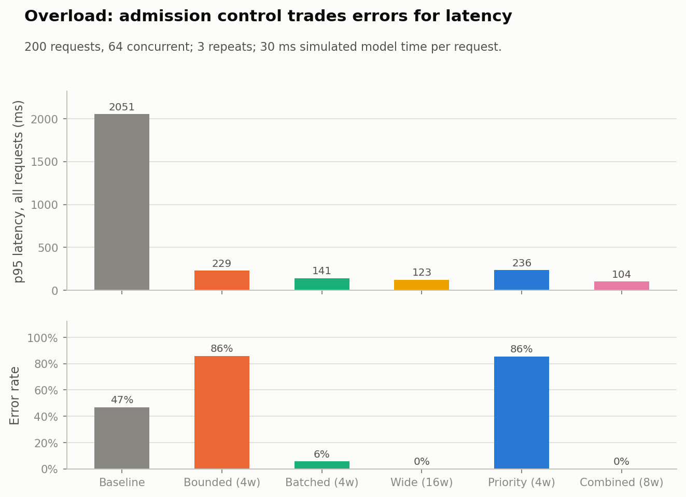
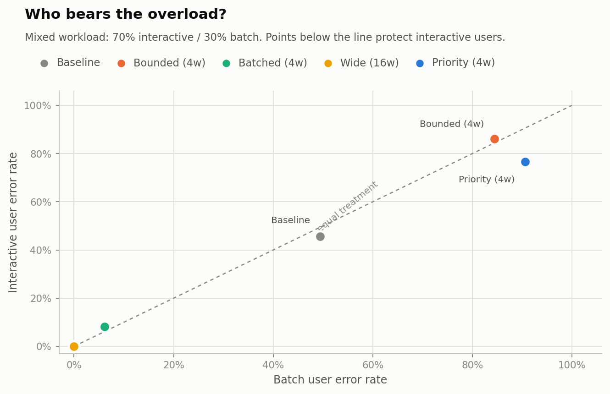

# Inference service

**A bounded local inference service with validation, admission control, batching,
priority, timeouts and cancellation**

**Decision:** release a **validated, bounded service with batching and an
interactive priority lane**, sized to the offered load. Do **not** release the
supplied baseline. When capacity is tight, **batch users bear the overload**
(they are queued and rejected first); interactive users keep a bounded lane.
Explicit `429`/`504` responses are better than the baseline's 2-second waits and
connection resets.

In the measured overload (200 requests, 64 concurrent, 30 ms simulated model
time):

| Configuration | Success | Error rate | Goodput | p95 latency | Main failure |
|---|---:|---:|---:|---:|---|
| Baseline (serial) | 53.3% | 46.7% | 25.0 rps | 2051 ms | 93 client connection errors |
| Bounded (4w) | 14.3% | 85.7% | 78.9 rps | 229 ms | 146 × 429, 25 × 504 |
| Batched (4w) | **94.3%** | **5.7%** | **435.9 rps** | **141 ms** | 11 × 429 |
| Wide (16w) | **100%** | **0%** | **489.6 rps** | **123 ms** | none at this load |
| Priority (4w) | 14.5% | 85.5% | 79.7 rps | 236 ms | 145 × 429, 26 × 504 |

The wide 16-worker configuration is the fastest at this load, but it buys that
with **4× the workers** and a **128-entry queue**; it has no priority isolation.
The priority 4-worker configuration is the only one that measurably separates
the classes under a mixed workload, but 4 workers are too few to carry the
offered load. The release policy combines the two ideas: **batching for
throughput, priority for interactive traffic, admission control for overload,
and enough capacity for the offered load.**

> This is an assessment scenario. The "model" is `len(text)` plus a 30 ms
> simulated compute cost, the load is closed-loop, and absolute throughput
> depends on the CPU. Sections 6–7 state what remains unknown.

---

## 1. Scenario and configurations

The supplied baseline is a single-threaded `HTTPServer` with no validation, no
queue bound, no timeout and no cancellation. I keep it unchanged and compare it
with four component configurations plus the recommended combination:

| Configuration | Workers | Queue | Batching | Queue deadline | Priority | What it tests |
|---|---:|---:|---|---:|---|---|
| `baseline` | 1 (serial) | OS backlog | none | none | none | Supplied reference |
| `bounded` | 4 | 32 | none | 200 ms | FIFO | Admission control + validation |
| `batched` | 4 | 32 | 8 / 10 ms wait | 300 ms | FIFO | Throughput at fixed capacity |
| `wide_fast` | 16 | 128 | none | 500 ms | FIFO | More capacity, no priority |
| `priority` | 4 | 32 | none | 200 ms | interactive first | Who bears overload |
| `priority_batched` | 8 | 64 | 8 / 10 ms wait | 300 ms | interactive first | Recommended combination (§3.6) |

The baseline is wrapped **only** to add the same 30 ms simulated model cost as
the bounded configurations, so the comparison is about serving policy rather
than about which handler performs `len(text)` faster. The original
`inference-baseline.py` is not modified.

## 2. Protocol

* **Model:** prediction is `len(text)`; each request sleeps 30 ms to simulate
  model compute. Batching uses 5 ms batch overhead and 0.25 efficiency, so a
  batch of 8 costs 65 ms.
* **Server isolation:** each server runs in a separate `multiprocessing` child
  process. The client runs in the parent, so the GIL is not shared between the
  load generator and the service.
* **Load:** closed-loop, fixed concurrency:
  * `nominal`: 40 requests, concurrency 4, all interactive;
  * `overload`: 200 requests, concurrency 64, all interactive;
  * `mixed`: 200 requests, concurrency 64, 70% interactive / 30% batch.
  Each scenario is repeated 3 times with a fresh server; tables report the mean.
* **Validation:** JSON object, `text` string, length ≤ 2000, `class` in
  {interactive, batch}; invalid requests get 400.
* **Admission:** `put_nowait` into a bounded `PriorityQueue`; full queue → 429.
  Interactive requests have priority over batch requests when enabled.
* **Timeout:** the handler waits at most until the request's queue deadline; a
  queued request that misses it gets 504 and is not processed. A task already
  in service is marked cancelled after the fact.
* **Cancellation:** `POST /cancel` with `{"request_id": ...}`; queued tasks are
  skipped with 499, in-service tasks return `cancelled: false`.
* **Batching:** a worker takes up to 8 tasks or waits 10 ms, whichever comes
  first; each response carries its own `request_id`, prediction and batch size.
* **Connection backlog:** the bounded servers use `request_queue_size=128`; the
  supplied baseline keeps the stdlib default of 5 (a real baseline limitation).
* **Targeted tests:** validation, queue timeout, cancellation, ordering, and
  prediction correctness are tested separately from the load scenarios.

## 3. Results

### 3.1 Nominal (40 requests, concurrency 4)

| Configuration | Throughput | Goodput | p50 | p95 | p99 | Errors | Mean batch |
|---|---:|---:|---:|---:|---:|---:|---:|
| Baseline | 31.7 rps | 31.7 rps | 125.7 ms | 127.0 ms | 127.4 ms | 0% | — |
| Bounded | 116.0 rps | 116.0 rps | 33.2 ms | 34.3 ms | 41.4 ms | 0% | 1.00 |
| Batched | 78.5 rps | 78.5 rps | 48.0 ms | 65.2 ms | 66.1 ms | 0% | 1.13 |
| Wide | 118.2 rps | 118.2 rps | 33.1 ms | 34.0 ms | 37.3 ms | 0% | 1.00 |
| Priority | 119.7 rps | 119.7 rps | 33.1 ms | 34.0 ms | 34.5 ms | 0% | 1.00 |

At low concurrency, the serial baseline is **4× slower** than the bounded
configs (one request at a time; four clients queue behind it). Batching is
**worse** here: only ~1.1 requests per batch form, so the 10 ms batch wait is
pure added latency. Batching is a throughput tool for high concurrency, not a
default for interactive traffic.

### 3.2 Overload (200 requests, concurrency 64)

| Configuration | Success | Error rate | Offered rps | Goodput | p50 | p95 | p99 | p95 (success) | 429 | 504 | Client errors | Queue p95 | Mean batch |
|---|---:|---:|---:|---:|---:|---:|---:|---:|---:|---:|---:|---:|---:|
| Baseline | 53.3% | 46.7% | 46.8 | 25.0 | 1811 ms | 2051 ms | 2163 ms | 2005 ms | 0 | 0 | 93.3 | — | — |
| Bounded | 14.3% | 85.7% | 549.9 | 78.9 | 22.6 ms | 229.3 ms | 234.9 ms | 215.2 ms | 146.3 | 25.0 | 0 | 213.7 ms | 1.00 |
| Batched | 94.3% | 5.7% | 463.2 | 435.9 | 130.3 ms | 141.2 ms | 149.2 ms | 141.3 ms | 11.3 | 0 | 0 | 63.0 ms | 7.46 |
| Wide | 100% | 0% | 489.6 | 489.6 | 121.7 ms | 123.5 ms | 124.2 ms | 123.5 ms | 0 | 0 | 0 | 94.0 ms | 1.00 |
| Priority | 14.5% | 85.5% | 548.7 | 79.7 | 24.3 ms | 235.6 ms | 238.2 ms | 218.2 ms | 145.3 | 25.7 | 0 | 213.7 ms | 1.00 |

The overload tells three different stories:

* **Baseline:** the serial server cannot drain the offered load. Throughput is
  capped near 25 goodput rps, p95 is ~2 s, and 93 of 200 requests fail at the
  connection level. There is no explicit overload signal.
* **Bounded / priority with 4 workers:** admission control keeps p95 around
  230 ms by rejecting **86%** of requests (429/504). The latency is bounded, but
  the goodput is only ~79 rps. This is a valid overload policy, not a capacity
  solution.
* **Batched / wide:** batching at 4 workers raises goodput to **436 rps** with a
  141 ms p95; the 16-worker configuration reaches **490 rps** with a 123 ms p95
  and no errors. More capacity and batching are what actually serve the load.

`Wide` is the best raw configuration in this scenario, but it is a capacity
purchase: 16 workers, a 128-entry queue and a 500 ms deadline. Its tail is
bounded only by that queue; a load beyond it would surface 429/504. The
experiment does not push it past its capacity, so this result is conditional.

### 3.3 Mixed workload (70% interactive / 30% batch)

| Configuration | Interactive p95 | Batch p95 | Interactive error | Batch error | Overall goodput |
|---|---:|---:|---:|---:|---:|
| Baseline | 2045 ms | 2043 ms | 45.7% | 49.4% | 24.9 rps |
| Bounded | 232.9 ms | 225.1 ms | 86.2% | 84.4% | 83.5 rps |
| Batched | 143.0 ms | 143.7 ms | 8.1% | 6.1% | 430.3 rps |
| Wide | 123.5 ms | 123.5 ms | 0% | 0% | 489.5 rps |
| Priority | **205.4 ms** | **228.1 ms** | **76.7%** | **90.6%** | 115.1 rps |

Only the priority configuration separates the classes in the intended
direction: interactive error **76.7% vs batch 90.6%**, and interactive p95
**205 ms vs batch 228 ms**. The batch users bear the overload. The effect is
modest because 4 workers are too few to carry the load; the policy is correct,
the capacity is not. The wide configuration treats both classes equally
(0%/0%), which is fine when there is enough capacity and problematic when there
is not. The batched configuration is close to equal treatment but with 4
workers and batched throughput.

### 3.4 Validation

| Configuration | invalid JSON | missing text | text not string | text > 2000 | unknown class |
|---|---|---|---|---|---|
| Baseline | connection reset | **200** | connection reset | **200** | **200** |
| Bounded | 400 | 400 | 400 | 400 | 400 |
| Batched | 400 | 400 | 400 | 400 | 400 |
| Wide | 400 | 400 | 400 | 400 | 400 |
| Priority | 400 | 400 | 400 | 400 | 400 |

The baseline accepts a missing `text` (predicts 0), a 2001-character text and an
unknown class; a non-string `text` raises and resets the connection. This alone
is a reason not to release it.

### 3.5 Targeted tests

| Test | Result | Evidence |
|---|---|---|
| Queue timeout | pass | first request 200, second (queued past deadline) 504 |
| Queued cancellation | pass | two queued batch requests returned 499; cancel endpoint returned `cancelled: true` |
| In-service cancellation | pass | cancel after the worker started returned `cancelled: false`; the original request completed 200 |
| Ordering | pass | 100% of responses matched their `request_id`; 100% prediction match under batching |
| Validation | pass | all five invalid cases returned 400 on bounded configs |

### 3.6 Recommended combination (additional run)

The component comparison isolates validation, bounded concurrency, batching and
priority. The release recommendation combines them. `combined_policy.py` runs
the recommended configuration directly:

**`priority_batched`:** 8 workers, queue 64, batch 8 / 10 ms wait, priority.

| Scenario | Success | Error rate | Goodput | p50 | p95 | p99 | Mean batch | Interactive p95 | Batch p95 |
|---|---:|---:|---:|---:|---:|---:|---:|---:|---:|
| Nominal (40 / 4) | 100% | 0% | 73.7 rps | 52.0 ms | 61.7 ms | 63.8 ms | 1.00 | 61.7 ms | — |
| Overload (200 / 64) | **100%** | **0%** | **699.2 rps** | 79.3 ms | **103.8 ms** | 106.3 ms | 6.49 | 103.8 ms | — |
| Mixed (200 / 64) | **100%** | **0%** | **674.1 rps** | 80.0 ms | **106.6 ms** | 114.2 ms | 6.07 | 104.9 ms | 108.0 ms |

This directly supports the release policy:

* under the measured overload it beats every component configuration on goodput
  (699 vs 436 for `batched`, 490 for `wide`) and on p95 (104 vs 141 / 123 ms),
  with **zero errors**;
* the priority lane has little effect at this capacity because nothing needs to
  be shed; it is insurance for the load beyond capacity, not a throughput
  feature;
* at nominal concurrency it is **slower** than `bounded` (61.7 vs 34.3 ms p95)
  because batches barely form and the 10 ms batch wait is pure latency. Batching
  is a throughput tool, not a low-latency default.

Validation on the combined configuration: all five invalid cases return 400
(see `results/combined_policy_validation.csv`).

### 3.7 Figures





## 4. Release policy and who bears the cost

**Release:** a validated, bounded service with:

1. **Validation** on every request (400 on invalid input);
2. **Bounded concurrency + admission queue** (429 when full);
3. **A queue deadline** (504 rather than an unbounded wait);
4. **Batching for batch/throughput traffic** (the 4-worker batched config is
   the best use of limited capacity: 436 rps goodput, 141 ms p95);
5. **An interactive priority lane** (the only policy that measurably protects
   interactive users: 76.7% vs 90.6% error under mixed overload);
6. **Capacity sized to the offered load** (the 16-worker configuration shows
   what capacity buys; 4 workers with either policy shed 85% of the overload).

The recommended configuration is measured directly in Section 3.6:
**`priority_batched`** (8 workers, queue 64, batch 8 / 10 ms, priority) reaches
**699 rps goodput, 104 ms p95 and 0% errors** under the measured overload.

**Do not release:** the supplied serial baseline. It has no validation, no
bound, no timeout, no cancellation, and under overload it produces 2-second
waits and 93 connection errors.

**Who bears the cost of overload:** with the combined config at the measured
load, nobody is shed (0% errors); the priority lane is insurance for the load
beyond capacity. When that capacity is exhausted, batch users are queued and
rejected first; interactive users keep the priority lane; the operations team
gets explicit 429/504 counters and queue metrics instead of the baseline's
silent OS-backlog waits. This is a value choice, not a technical necessity. A
team that values batch completion more than interactive latency could reverse
the priority; it should do so explicitly and report the consequences.

**If forced to release one measured configuration today:** `priority_batched`
is the recommended default for the measured overload (699 rps goodput, 104 ms
p95, zero errors). If the workload is low-load interactive-only, use `bounded`
(34 ms p95) or disable batching; the combined config's 62 ms nominal p95 is the
price of throughput. The 4-worker `batched` and 16-worker `wide` configs remain
component references.

## 5. What remains uncertain

* **The "model" is simulated.** The 30 ms compute cost and `len(text)`
  prediction are a stand-in; absolute rps numbers are not a production claim.
* **Closed-loop load.** 64 concurrent clients, fixed request count, no Poisson
  arrivals or burstiness. The wide configuration's queue/tail behavior at a
  load beyond 200 requests is untested.
* **The combination was measured at one capacity.** `priority_batched` (8
  workers, queue 64) handles the measured overload with zero errors; a larger
  burst beyond its queue would produce 429/504. The priority lane has little
  effect when capacity is sufficient; it matters when the queue is full.
* **Batching at nominal load.** The combined config's nominal p95 is 61.7 ms
  vs 34.3 ms for `bounded`; batching is a throughput tool, not a low-latency
  default.
* **The baseline comparison is controlled, not identical.** I inject the same
  30 ms model cost into the supplied baseline handler; the original file is
  unchanged. The baseline also keeps the stdlib listen backlog of 5, which is
  part of why it fails under 64 concurrent connections.
* **Timeout semantics.** The deadline is a total wait budget from arrival, not
  a pure queue-wait; a request that starts near the deadline can be timed out
  during service. The main configs use 30 ms service against 200–500 ms
  deadlines, so the effect is small; the targeted timeout test is configured to
  let the first request complete.
* **No authentication/TLS/persistent connections.** Localhost only; not a
  production deployment.
* **No real user feedback.** The value judgment that interactive latency is
  worth protecting is assumed, not measured.

## 6. Assumptions

1. The supplied baseline is the reference; its handler is wrapped with the same
   simulated 30 ms model cost for a fair serving-policy comparison.
2. The model cost is 30 ms per item; batching uses 5 ms overhead and 0.25
   efficiency. These are simulation parameters.
3. The client timeout is 2.5 s; the bounded queue deadlines are 200–500 ms.
4. The load is closed-loop with 4/64 concurrency and fixed request counts.
5. `429` means admission rejection, `504` means queue-deadline expiry, `499`
   means the client cancelled after the deadline; these are reported separately.
6. The priority policy makes interactive requests jump ahead of batch requests;
   it does not reserve a hard worker partition.
7. The experiment measures a local service on a shared CPU; absolute latency
   includes process scheduling noise.

## 7. Limitations, failed cases and what remains unknown

* **Baseline connection errors:** the serial server's default backlog of 5
  causes 93 connection failures at 64 concurrency. This is a real baseline
  limitation, but it also means part of the gap is connection handling, not
  model serving.
* **The 4-worker priority component is under-provisioned:** it sheds 85% of the
  overload; the class separation is directionally correct but the absolute
  goodput is low. The 8-worker `priority_batched` combination in Section 3.6 is
  the measured release candidate.
* **Priority is insurance, not throughput:** at 8 workers the measured mixed
  load has zero errors for both classes, so the priority lane does not change
  the outcome; it matters when the queue is full. The experiment does not push
  the combined config past its 64-entry queue.
* **Wide config is untested beyond its capacity:** its 128 queue / 500 ms
  deadline bounds the tail; a larger burst would produce 429/504.
* **Batching hurts at low concurrency:** nominal p95 65 ms (4-worker batched)
  and 61.7 ms (combined) vs 34 ms for `bounded`; batching should be enabled for
  batch/throughput traffic, not used as the default for interactive requests.
* **Timeout/cancellation are cooperative:** a worker cannot interrupt a
  `time.sleep`; a task already in service finishes, and its response is
  suppressed/marked cancelled. A real service would need cooperative checks or
  process isolation for hard cancellation.
* **No fairness within the priority class:** all interactive requests are FIFO;
  a heavy interactive user can still crowd out others.
* **No model-level batching benchmark:** the 0.25 efficiency is assumed, not
  measured from a real model.
* **No production capacity claim:** the numbers are relative and CPU-specific.

## 8. Reproducibility

Requirements: Python 3.11 (tested with 3.11.1), `numpy==1.26.4`,
`pandas==2.2.3`, `matplotlib==3.10.0`.

```bash
python -m pip install -r requirements.txt
python service_experiment.py
python combined_policy.py
python make_figures.py
```

`service_experiment.py` writes:

```
results/report.txt
results/metadata.json
results/scenario_summary.csv      # config x scenario metrics (mean of repeats)
results/scenario_runs.csv         # per-repeat metrics
results/client_requests.csv       # every client request
results/server_requests.csv       # server-side queue/service records
results/mixed_by_class.csv        # interactive vs batch p95/error
results/validation_results.csv
results/targeted_tests.json       # timeout, queued/in-service cancellation, ordering
```

`combined_policy.py` writes:

```
results/combined_policy.csv
results/combined_policy_runs.csv
results/combined_policy_validation.csv
results/combined_policy_server_requests.csv
results/combined_policy_metadata.json
```

`make_figures.py` writes `results/figures/fig1_overload.png` and
`fig2_who_bears_overload.png`.

The server runs in a spawned child process; each scenario gets a fresh server.
The experiment is not bit-for-bit deterministic in wall-clock latency (thread
scheduling and CPU load vary), so tables report the mean of 3 repeats. The
functional tests (validation, timeout, cancellation, ordering) are deterministic
in their pass/fail outcome.

### Files

| File | Purpose |
|---|---|
| `service_experiment.py` | Service, load generator, scenarios, targeted tests |
| `combined_policy.py` | Measures the recommended `priority_batched` configuration |
| `make_figures.py` | Report figures |
| `results/` | Report, summaries, per-request records, tests |
| `inference-baseline.py` | Supplied baseline, kept unchanged |
| `inference-brief.md` | Supplied brief |

## 9. AI assistance disclosure

AI assistance (Claude Code) was used to implement the service and experiments,
generate the figures and draft this README and the decision journal. The
experiment was re-run and the reported numbers were checked during preparation.
The candidate owns the final submission and is responsible for the reasoning and
for defending it without AI assistance during an on-site interview; see the note
at its top.

## 10. Requirement checklist

| Brief requirement | Where it is met |
|---|---|
| Add validation, bounded concurrency or batching | Section 1–2: all three, plus priority, timeout and cancellation |
| Measure latency, throughput and errors against baseline | Sections 3.1–3.3; `scenario_summary.csv` |
| Test overload | Section 3.2 (200 requests, 64 concurrent) |
| Test ordering | Section 3.5: 100% request_id/prediction match under batching |
| Test cancellation | Section 3.5: queued requests return 499; in-service cancel returns `cancelled: false` and completes 200 |
| Test timeouts | Section 3.5: first request 200, queued second 504 |
| Measure the recommended release policy | Section 3.6; `combined_policy.py`; `results/combined_policy.csv` |
| Decision journal (four questions) | `decision-journal.md` |
| AI assistance disclosed | Section 9 and the journal note |
