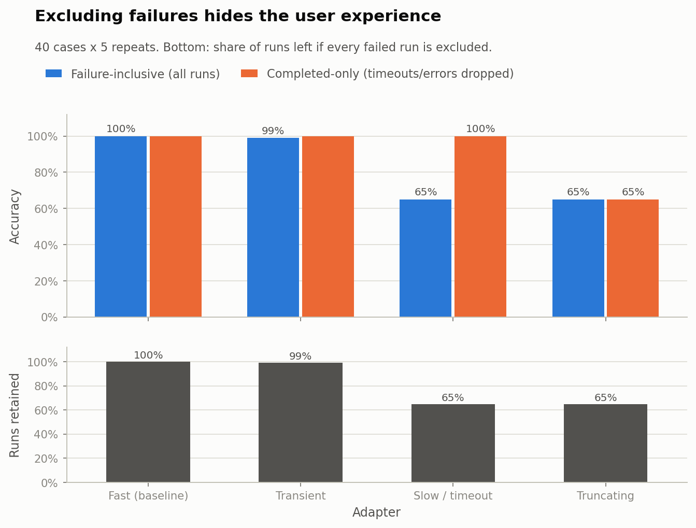
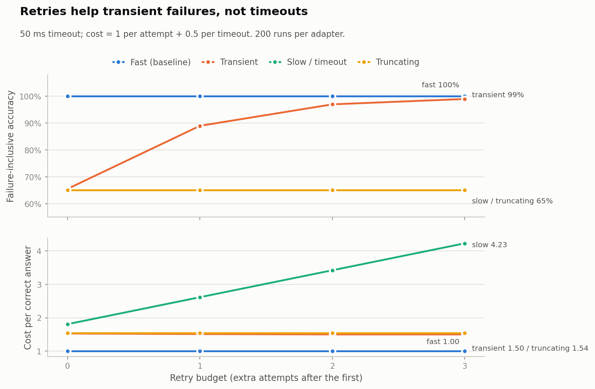
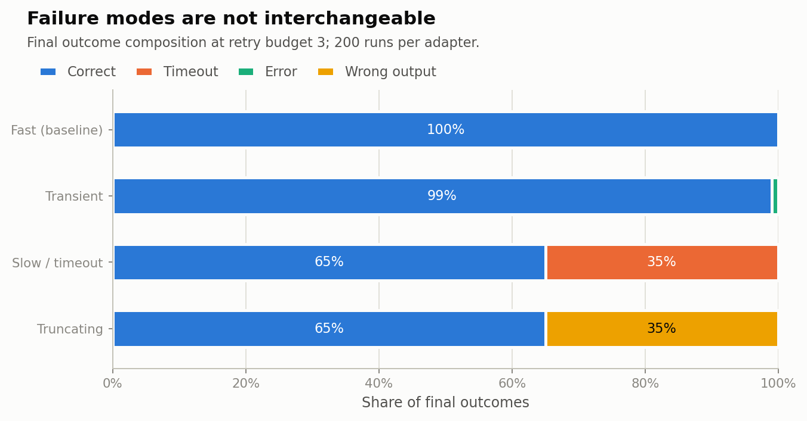

# Evaluation runner

**Repeatable adapter evaluation with visible failures, retries and costs**

**Decision:** publish a **tiered ranking**, not a strict 1–2–3–4 list.

* **Tier 1 — `fast`:** the supplied baseline adapter. 100% correct, cost per
  correct answer 1.00, p95 latency 0.24 ms. Clear default.
* **Tier 2 — `transient`:** 99.0% failure-inclusive accuracy at 3 retries
  (97.0% at 2), cost per correct 1.50, no silent wrong answers. Acceptable as a
  fallback if retries are budgeted and the tail is acceptable.
* **Not recommended — `slow` and `truncating`:** both are correct on only 65% of
  runs. I **decline to rank them against each other on accuracy**: they are
  exactly tied by construction, but they fail in different ways. `slow` times
  out (visible, expensive: cost per correct 4.23, p95 253 ms when failures are
  included) and `truncating` returns silently wrong answers (cheap: 1.54, p95
  0.18 ms). A cost-only ranking would put the silent-wrong adapter above the
  timeout adapter, which is the wrong decision for users.

> This is an assessment scenario, not a production benchmark. The adapters are
> small synthetic proxies, the cost model is assumed, and latency is measured in
> a shared CPU process. Sections 6–7 state what remains unknown.

---

## 1. Scenario and adapters

The team wants a clear adapter ranking. The supplied baseline contains one
adapter (`text.upper()`). I use it as `fast` and add three small adapters that
cover distinct failure modes. This is an explicit assumption: only one adapter
was supplied, and a ranking needs at least two.

| Adapter | Behaviour | Why it is in the suite |
|---|---|---|
| `fast` | `text.upper()`; always correct, fast | Supplied baseline / control |
| `transient` | Correct when it completes; raises a deterministic exception on 35% of attempts | Transient errors where retries can help |
| `slow` | Correct; sleeps 10 ms on inputs ≤ 8 chars, 80 ms on longer inputs; 50 ms timeout | Visible timeouts; retries do not help |
| `truncating` | Returns `text.upper()[:8]`; correct for ≤ 8 chars, silently wrong for longer inputs | Silent wrong answers; retries do not help |

The 40-case suite contains **26 short** and **14 long** inputs. `slow` and
`truncating` are therefore correct on exactly the same 26 cases. Their
failure-inclusive accuracy is identical (65%), but one fails with timeouts and
the other with silent wrong outputs. This is deliberate: it makes the ranking
problem visible rather than letting accuracy hide the failure mode.

## 2. Protocol

* **Runs:** 40 cases × 5 repeats = **200 base runs per adapter** (800 total).
* **Timeout:** 50 ms per attempt, enforced with a daemon thread + `join(timeout)`.
* **Retries:** 0–3 extra attempts. Retry only timeouts and exceptions. **Never
  retry a wrong output**: a deterministic wrong answer would burn budget and
  could hide a quality bug behind a lucky retry.
* **Cost model:** 1 unit per attempt + 0.5 units per timeout. The timeout penalty
  represents capacity that stayed occupied. The model is an assumption; Section
  5.4 varies the penalty.
* **Per-example record:** adapter, case, repeat, attempt, input, expected,
  output, correctness, outcome (`correct`/`wrong`/`timeout`/`error`), detail,
  latency, cost.
* **Repeatability:** a small subset (5 cases × 2 repeats × all adapters) is run
  twice and the deterministic fields are compared. The check passed with 44
  records and checksum `111a722e5039611c`.
* **No hidden failures:** `run_outcomes.csv` contains all 800 base runs, and
  `failure_cases.csv` contains all 142 final failures (70 `slow` timeouts, 70
  `truncating` wrong answers, 2 `transient` exhausted retries).
* **Bootstrap:** 2,000 case-level clustered resamples; all repeats for a case
  stay together. This respects the repeated-run structure.

## 3. Results

### 3.1 Headline at retry budget 3 (all runs counted)

| Adapter | Runs | Correct | Completed | Wrong | Timeout | Error | Accuracy (all) | Accuracy (completed) | Retained fraction | Mean attempts | Cost / correct | p95 latency (all) | p95 latency (completed) |
|---|---:|---:|---:|---:|---:|---:|---:|---:|---:|---:|---:|---:|---:|
| `fast` | 200 | 200 | 200 | 0 | 0 | 0 | **100.0%** | 100.0% | 100.0% | 1.00 | **1.00** | 0.24 ms | 0.24 ms |
| `transient` | 200 | 198 | 198 | 0 | 0 | 2 | **99.0%** | 100.0% | 99.0% | 1.49 | **1.50** | 0.61 ms | 0.58 ms |
| `slow` | 200 | 130 | 130 | 0 | 70 | 0 | **65.0%** | **100.0%** | 65.0% | 2.05 | 4.23 | **252.7 ms** | **11.2 ms** |
| `truncating` | 200 | 130 | 200 | 70 | 0 | 0 | **65.0%** | 65.0% | 65.0% | 1.00 | 1.54 | 0.18 ms | 0.18 ms |

Two numbers carry the whole argument:

* `slow` is **100% accurate among completed runs** but only **65% when every
  run is counted**. A reader who sees the completed-only column would think it
  is perfect; a user hitting a long input waits four timeouts (p95 253 ms) and
  gets no answer.
* `truncating` never raises an error and is the **cheapest adapter per correct
  answer after `fast`** (1.54), but **35% of its answers are silently wrong**.
  Cost alone would reward it for failing quietly.

### 3.2 Retry budget tradeoff

| Adapter | Budget 0 | Budget 1 | Budget 2 | Budget 3 | Cost / correct at 3 |
|---|---:|---:|---:|---:|---:|
| `fast` | 100.0% | 100.0% | 100.0% | 100.0% | 1.00 |
| `transient` | 65.5% | 89.0% | 97.0% | 99.0% | 1.50 |
| `slow` | 65.0% | 65.0% | 65.0% | 65.0% | 4.23 |
| `truncating` | 65.0% | 65.0% | 65.0% | 65.0% | 1.54 |

Retries help only the failure mode they can fix. `transient` rises from 65.5%
to 99.0% (the cost per correct stays near 1.50 because the successful retries add
few attempts). `slow` gains nothing and its cost per correct rises from 1.81 to
4.23. `truncating` is never retried because its output is wrong, not an
exception. **A retry budget is not a quality fix.**

### 3.3 Reporting lenses at retry budget 3

| Lens | Fast | Transient | Slow | Truncating | What it hides |
|---|---|---|---|---|---|
| Exclude every failed run | 1 (100%) | 1 (100%) | 1 (100%) | 1 (100%) | All failures; all four look perfect |
| Completed-only (drop timeouts/errors) | 1 (100%) | 1 (100%) | 1 (100%) | 4 (65%) | The 70 slow timeouts and 2 transient errors |
| Failure-inclusive | 1 (100%) | 2 (99%) | 3 (65%, tie) | 3 (65%, tie) | Nothing about accuracy; ties need a tie-break |
| Cost per correct | 1 (1.00) | 2 (1.50) | 4 (4.23) | 3 (1.54) | Accuracy; rewards cheap silent failures if used alone |

The first lens is the one to reject. Excluding failures makes every adapter
100% correct and the ranking meaningless. The second lens still makes `slow`
look perfect. The third is the primary reporting metric. The fourth is a useful
secondary lens, but it must never be the only one: it puts `truncating` above
`slow` despite both being 65% accurate, because silent wrong answers are cheap.

### 3.4 Bootstrap (2,000 clustered resamples, budget 3)

| Adapter | Accuracy mean | 95% CI | Cost / correct mean | 95% CI |
|---|---:|---:|---:|---:|
| `fast` | 100.0% | [100.0%, 100.0%] | 1.00 | [1.00, 1.00] |
| `transient` | 99.0% | [97.5%, 100.0%] | 1.50 | [1.40, 1.60] |
| `slow` | 65.0% | [50.0%, 80.0%] | 4.36 | [2.50, 7.00] |
| `truncating` | 65.0% | [50.0%, 80.0%] | 1.56 | [1.25, 2.00] |

The `fast` and `transient` intervals touch at 100%; the data do not establish a
significant accuracy difference between them. `slow` and `truncating` have
exactly the same interval because they are correct on the same cases. Their
rank order (3 vs 4) is created only by the cost tie-break, not by accuracy. That
is why the report tiers them instead of declaring a winner.

### 3.5 Cost sensitivity (timeout penalty)

| Timeout penalty | Fast | Transient | Slow | Truncating |
|---:|---:|---:|---:|---:|
| 0.0 | 1.00 | 1.50 | 3.15 | 1.54 |
| 0.5 (used) | 1.00 | 1.50 | 4.23 | 1.54 |
| 1.5 | 1.00 | 1.50 | 6.39 | 1.54 |

The cost ordering is stable (`fast` < `transient` < `truncating` < `slow`), but
the magnitude of `slow`'s disadvantage depends on the timeout penalty. Since the
penalty is an assumption, the report gives the table rather than a single cost
number.

### 3.6 Failure cases

All 142 final failures are in `results/failure_cases.csv`. A sample:

| Adapter | Case | Input | Expected | Attempts | Final outcome | Detail | Cost |
|---|---|---|---|---:|---|---|---:|
| `slow` | C18 | `evaluation` | `EVALUATION` | 4 | timeout | exceeded 50 ms | 6.00 |
| `slow` | C19 | `reproducible` | `REPRODUCIBLE` | 4 | timeout | exceeded 50 ms | 6.00 |
| `truncating` | C18 | `evaluation` | `EVALUATION` | 1 | wrong | output `EVALUATI` | 1.00 |
| `transient` | C39 | `longer phrase here` | `LONGER PHRASE HERE` | 4 | error | deterministic transient failure | 4.00 |

The per-example log also records every retry, including the attempts that
eventually succeeded. Nothing is deleted from the record.

### 3.7 Figures







## 4. What I would include, qualify or decline to rank

**Include:**

* every base run, including timeouts, exceptions and wrong outputs;
* per-example failure records and the final failure table;
* failure-inclusive accuracy as the primary metric;
* cost per correct answer **and** total retry cost;
* latency with failures included, alongside completed-only latency;
* the retained fraction (correct runs / all runs) whenever a success-only number
  is shown;
* bootstrap intervals and the fact that `fast` and `transient` overlap.

**Qualify:**

* `transient`'s 99% depends on a 3-retry budget; at 2 retries it is 97%, at 0 it
  is 65.5%. Quote the budget with the number.
* `slow`'s 100% completed-only accuracy is not a quality result; it is a
  denominator artifact. Quote the 65% failure-inclusive number and the 253 ms
  p95.
* `truncating`'s 1.54 cost per correct is cheap because wrong answers return
  quickly. Do not present it as efficiency.

**Decline to rank:**

* `slow` vs `truncating` on accuracy: exactly tied at 65% by construction. The
  tie-break is a value judgment about visible timeouts vs silent wrong answers,
  not a statistical result. I report both and recommend against both.
* A strict `fast` vs `transient` ordering: their bootstrap intervals overlap at
  100%. `fast` is still the practical default because it is also the cheapest
  and fastest, but I do not claim a significant accuracy advantage.

**Recommend:**

* `fast` as the default adapter;
* `transient` as a fallback with a retry budget (2 for interactive, 3 for
  batch/offline), because the third retry buys ~2 percentage points at a flat
  cost per correct but adds tail attempts;
* never retry silent wrong outputs;
* do not deploy `slow` or `truncating` without fixing the underlying failure.

## 5. Assumptions

1. Only one adapter was supplied (`text.upper()`); the other three are small
   synthetic proxies created for this assessment.
2. The 40-case suite is a small, hand-built proxy; it is not a production
   benchmark.
3. The 50 ms timeout is an assumption. The slow adapter's 10/80 ms behaviour is
   deterministic; the relative story does not depend on this exact threshold.
4. The cost model (1 per attempt, 0.5 per timeout) is an assumption. Section 3.5
   varies the timeout penalty.
5. The transient failure rate (35%) and the retry policy are fixed in advance;
   results are deterministic given the seed.
6. Latency is wall-clock in a shared CPU process. Absolute values are small and
   noisy; the report uses them as relative evidence, not as a production SLO.
7. A timeout is a reporting boundary, not hard cancellation: Python cannot kill
   a thread. Abandoned adapter calls may finish in the background; the timeout
   penalty reflects that occupied capacity.

## 6. Limitations and what remains unknown

* **Small case set.** 40 cases × 5 repeats; the bootstrap intervals are wide
  (e.g., 65% [50%, 80%]). More cases would tighten them.
* **Synthetic adapters.** The failure rates and latency profiles are designed,
  not observed in a real adapter ecosystem.
* **No real user feedback.** The ranking assumes failures and wrong answers are
  both bad; it does not measure the actual downstream cost of a silent wrong
  answer or a timeout.
* **Timeout cancellation.** The runner records timeouts but cannot forcibly stop
  the underlying work. A production runner would need process isolation or
  cooperative cancellation.
* **Cost model.** The 1 + 0.5 model is arbitrary; a real team's cost depends on
  compute pricing and review capacity.
* **No adversarial or distribution-shift cases.** The 40 cases are fixed; a
  different input distribution can change the failure mix.
* **Transient errors are deterministic pseudo-random.** This makes the
  experiment reproducible, but it is not a model of real network failures.

## 7. Reproducibility

Requirements: Python 3.11 (tested with 3.11.1), `numpy==1.26.4`,
`pandas==2.2.3`, `matplotlib==3.10.0`.

```bash
python -m pip install -r requirements.txt
python runner_experiment.py
python make_figures.py
```

`runner_experiment.py` writes:

```
results/report.txt
results/metadata.json
results/per_example.csv          # every attempt, including retries/failures
results/run_outcomes.csv         # every base run, final outcome
results/budget_outcomes.csv      # run x retry-budget view
results/adapter_summary.csv      # adapter x budget metrics
results/ranking_policies.csv     # four reporting lenses
results/bootstrap_metrics.csv
results/bootstrap_ranks.csv
results/cost_sensitivity.csv
results/failure_cases.csv        # all final failures, kept visible
```

`make_figures.py` writes `results/figures/fig1_exclusion_bias.png`,
`fig2_retry_tradeoff.png` and `fig3_failure_modes.png`.

The experiment is deterministic in its outcome fields (seeded failure
simulation; fixed cases). Latency varies between runs and is reported as
measured; the repeatability check compares outcomes, not wall-clock latency.

### Files

| File | Purpose |
|---|---|
| `runner_experiment.py` | Full runner and analysis |
| `make_figures.py` | Report figures |
| `results/` | Report, per-example records, summaries, failures |
| `runner-baseline.py` | Supplied baseline, kept unchanged |
| `runner-brief.md` | Supplied brief |

## 8. AI assistance disclosure

AI assistance (Claude Code) was used to implement the runner, generate the
figures and draft this README and the decision journal. The experiment was
re-run and the reported numbers were checked during preparation. The candidate
owns the final submission and is responsible for the reasoning and for defending
it without AI assistance during an on-site interview; see the note at its top.

## 9. Requirement checklist

| Brief requirement | Where it is met |
|---|---|
| Implement repeatable runs across supplied adapters | Section 2; deterministic seeds; repeatability check passed |
| Record per-example results, failures and cost | `per_example.csv` (1,107 attempts), `run_outcomes.csv` (800 runs), `failure_cases.csv` (142 failures) |
| Handle timeouts and retries without hiding failed cases | 50 ms timeout; retry timeouts/errors only; every attempt recorded; all final failures kept |
| Compare reporting/ranking policies | Section 3.3: exclude-all, completed-only, failure-inclusive, cost-aware |
| Report uncertainty | Section 3.4: clustered bootstrap CIs; Section 3.5 cost sensitivity |
| Decision journal (four questions) | `decision-journal.md` |
| AI assistance disclosed | Section 8 and the journal note |
